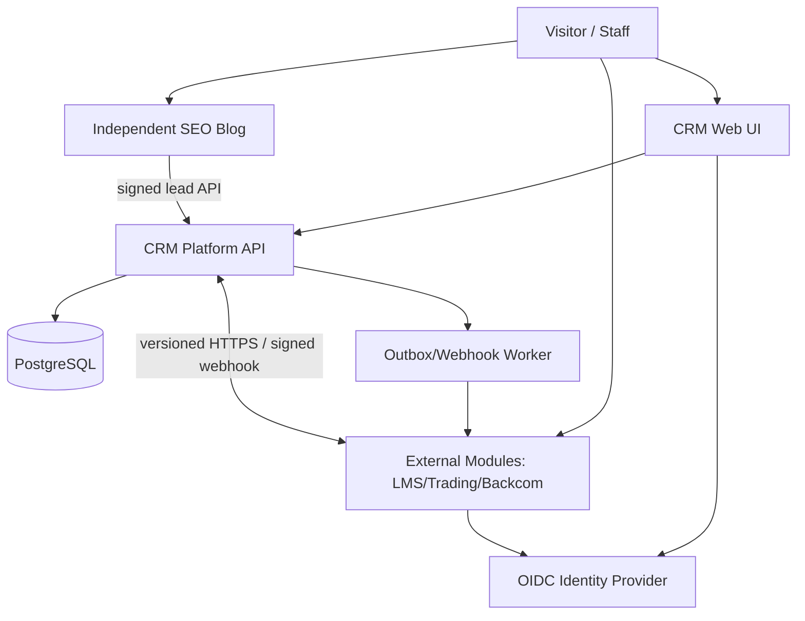

# C4 Architecture (Context / Containers)

## Context
CRM là customer system of record; Blog, LMS, Trading, Backcom là external systems. IdP quản lý identity. Mỗi app có thể chạy host khác, có DB riêng. Marketing automation tiêu thụ events CRM/module.

## Container view
- `crm-web`: React, Vite, TS; TanStack Router/Query, Tailwind, shadcn/ui; no secrets.
- `crm-api`: ASP.NET Core .NET 10; REST endpoints, authorization, domain services, installation, ingestion.
- `crm-worker`: .NET worker, dispatch outbox, retries, schedule reconciliations, background automation.
- `idp`: Keycloak/managed OIDC provider (separate credential/security boundary).
- `postgres`: modules `platform`, `crm`, `integration`, `automation`, `audit`, `outbox` schemas.
- `redis`: optional caching/rate limit; correctness must not require Redis.
- `demo-module`: independent frontend+API+store mock to prove integration.

## Runtime boundaries
- Same source repo initially is permissible, independent deployment for external module mandatory.
- API types are DTOs, not EF entities. No module-to-module DbContext access.
- In-process domain event is not sufficient as durable integration; persist outbox transactionally.
- For P1 broker, prefer RabbitMQ/NATS JetStream after requirements study; do not couple domain to transport.

## Failure matrix
| Failure | Expected |
|---|---|
| IdP temporarily offline | Existing tokens can validate against cached JWKS until expiry; new login may fail |
| Trading offline | CRM works; action queued/retried; shows pending status |
| CRM offline | Trading core works; integration outbox retries |
| Duplicate webhook | Same event ID yields idempotent success |
| DB unavailable | Mutations fail closed; never return accepted if not committed |
| Worker crash after HTTP send | Retry may duplicate; receiver idempotency required |
